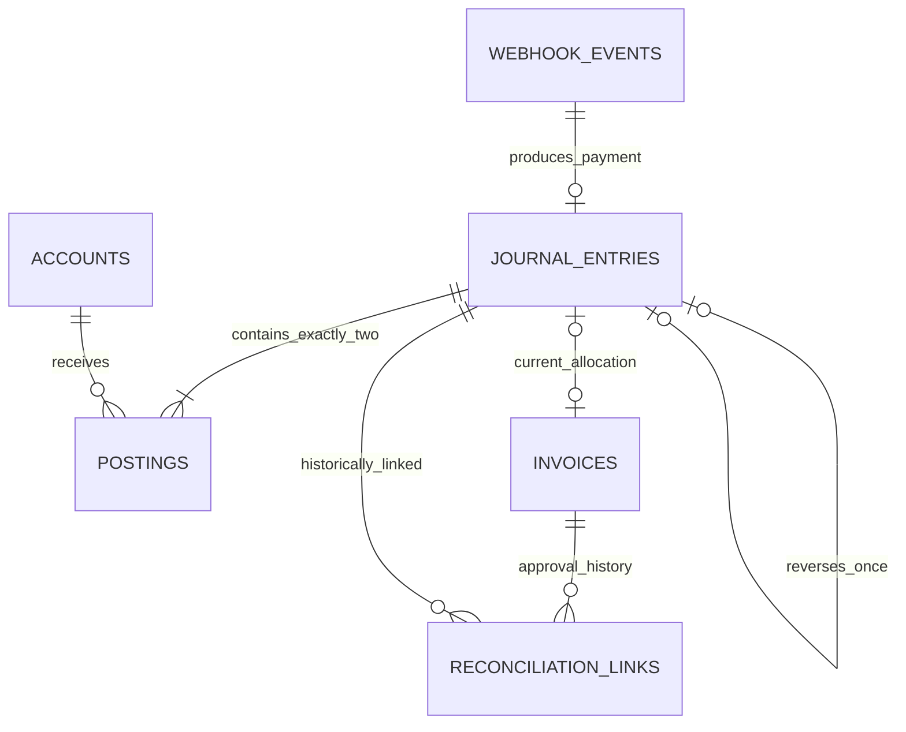

# LedgerSentinel Architecture and Module Plan

**Status:** Proposed architecture and database design — awaiting user review.  
**Date:** 2026-11-11  
**Product baseline:** [product.md](product.md), including confirmed decisions Q1-A, Q2-A, Q3-A, and Q4-A.  
**Authority:** Planning only. This document does not authorize implementation, dependency installation, migration execution, infrastructure changes, or deployment.

## 1. Scope and design decisions

Build a local portfolio demonstration with one workspace, one operator, synthetic settled incoming payments, exact USD amounts with at most two decimal places, full reversals, structured invoice import, and explicit human match approval. A reference can be absent or differ without preventing an otherwise eligible match. Imported invoices are evidence, not accounts-receivable or revenue records.

The product document remains a draft as a whole. This architecture uses its confirmed decisions and current requirements as its planning baseline; it does not silently approve or expand that document.

### 1.1 Architecture decisions for review

| Decision | Proposed choice | Reason and consequence |
| --- | --- | --- |
| Frontend profile | F1: one Next.js application at `apps/web` | One operator and one release boundary. No user/admin microfrontends. Requires architecture approval before frontend implementation. |
| Backend | One NestJS modular monolith, with HTTP and worker entry points | Keeps financial transactions local and allows queue work to run separately without splitting database ownership across services. |
| Persistence | PostgreSQL with Drizzle behind repository interfaces | PostgreSQL owns financial invariants and durable acceptance; services never access ORM objects. |
| Queue | Redis-backed BullMQ for delivery; PostgreSQL inbox for recovery | Queue delivery can repeat or disappear without losing the authoritative accepted work. |
| Reconciliation | Deterministic eligibility and explanation inside NestJS | Exact amount/currency plus human approval satisfies the selected MVP. No FastAPI, OCR, fuzzy percentages, or automatic links. |
| Money | Decimal strings at boundaries, exact integer-cent calculations internally, checked PostgreSQL `numeric` | Reject excess precision instead of rounding. Never use JavaScript `number` for financial calculations. |
| Workspace | One dataset per local deployment | No organizations, memberships, tenant identifiers, or claims of multi-tenant isolation. |
| Deployment | Reproducible local demonstration first | Public portfolio hosting is a later security and deployment decision, not part of executing this plan. |

**Alternatives considered:** The original multi-service/Python design is appropriate only after document extraction or independent service operation becomes a requirement; it adds no necessary capability to this MVP. A queue-only Redis design is smaller but cannot recover an accepted event after queue loss. A PostgreSQL-only dispatcher is a viable simpler alternative, but the proposed Redis/BullMQ delivery layer retains the original queue-learning objective while preserving a durable recovery source.

### 1.2 Existing toolkit conflicts and gaps

- Root `CLAUDE.md` is the engineering entry point. Some agent contracts refer to a nonexistent `.claude/CLAUDE.md`; use the root file explicitly.
- Historical `AGENTS.md` foundation/auth instructions refer to absent project records and a different user/admin microfrontend topology. The later product decisions define this draft's scope. Do not reconstruct missing auth decisions from those references.
- Linked `docs/specifications/` standards are absent in this copy. Available `.claude/` skills and rules were consulted; missing references are gaps, not evidence of compliance.
- Current config has queue/cache disabled, placeholder scope `@project`, and older auth defaults. This document proposes future settings; it does not modify config.
- Package management needs an explicit architecture decision: recommend pnpm 10.24.0 for workspace installation and frontend orchestration, with backend scripts invoked using `npm run` as required by `CLAUDE.md`. This requires clarifying the toolkit's backend “npm only” installation wording before scaffolding; do not create competing lockfiles.
- `AGENTS.md` specifies Node 24.10.x–24.x. No application manifests or lockfiles exist. NestJS, Next.js, React, Drizzle, PostgreSQL, Redis, and BullMQ versions must be selected as a compatible, supported set and pinned before implementation. Versions in pasted examples are references, not installed-version evidence.

## 2. System and folder boundaries

```text
Browser -> Next.js BFF -> NestJS HTTP API -> repository ports -> PostgreSQL
Simulator -> signed webhook -> durable PostgreSQL inbox
Inbox dispatcher -> Redis/BullMQ -> NestJS worker -> ledger transaction
```

PostgreSQL has one application data owner: NestJS. Next.js never connects to the database or Redis. Queue messages contain an inbox record ID, not an authoritative copy of financial data. Only the backend retrieves accepted payloads and decides their effects.

All paths below are proposed; none are created by this document.

```text
apps/
  api/
    src/
      main.ts                         HTTP bootstrap
      worker.ts                       worker/dispatcher bootstrap
      app.module.ts                   application composition
      gateway.module.ts               HTTP cross-cutting provider composition
      decorators/                     route/auth/request metadata
      filters/                        RFC-9457 mapping
      guards/                         AuthN, AuthZ, webhook signature verification
      interceptors/                   response and logging
      interfaces/                     trusted actor/request context
      middleware/                     request correlation, raw-body boundary
      pipes/                          boundary validation
      database/
        schema/                       Drizzle table declarations; single owner
        repositories/                 concrete repositories and transaction adapter
      ledger/
        domain/                       money, journal, repository ports, exceptions
        application/                  post-settlement and reverse use cases
        dto/                          ledger HTTP request/response DTOs
        ledger.controller.ts
        ledger.module.ts
      ingestion/
        domain/                       accepted event, inbox port, exceptions
        application/                  accept, dispatch, process, retry
        adapters/                     simulator normalization and queue adapter
        dto/
        ingestion.controller.ts
        ingestion.module.ts
      reconciliation/
        domain/                       invoice, match evidence, repository ports
        application/                  import, candidates, approve, history
        dto/
        reconciliation.controller.ts
        reconciliation.module.ts
      operations/                     processing projections and health
    drizzle/                          reviewed future migrations; none generated now
    test/                             backend integration and database tests
  web/
    src/
      app/                            route composition and allowlisted BFF
      features/                       ledger, ingestion, invoices, reconciliation
      components/                     app-shared composition
      lib/                            server API adapter, browser client, query keys
packages/
  contracts/                          transport schemas/types and problem codes
  ui/                                 shared shadcn primitives and semantic tokens
tools/
  simulator/                          future signed synthetic-event driver
tests/
  e2e/                                future complete demo acceptance scenarios
docs/
  product.md
  architecture.md
```

### 2.1 Dependency and ownership rules

- Routes compose features; features never import sibling features. Shared UI comes from `packages/ui`; per-feature copy lives in `messages.ts`.
- API controllers validate and delegate. Application use cases inject repository ports through Symbol tokens. Only concrete repositories import Drizzle.
- Backend modules expose narrow public capabilities through Nest module exports/imports. Other modules do not import their controllers, DTO internals, repositories, or schema files.
- `packages/contracts` contains public transport shapes, Zod schemas, stable problem codes, and serialization rules. No ORM types, database credentials, Nest services, React components, or business-state ownership.
- Backend DTO classes apply class-validator checks equivalent to shared transport constraints. Compatibility tests must prevent drift; TypeScript interfaces alone do not validate runtime input.
- One designated owner serializes contract edits; one database owner serializes schema and migration edits. Module implementation must not independently redefine them.
- `database/` owns an internal transaction/unit-of-work adapter. Its transaction handle stays inside infrastructure; application services receive semantic atomic operations, not Drizzle transactions.

## 3. Proper module execution plan

Before Module 1, review the product baseline, this architecture, schema, and operation contracts. Later, create `docs/execution.md` as the task tracker. No task tracker or implementation is generated by this planning request.

| Module | Owned capability | Depends on | Owned records | Completion gate |
| --- | --- | --- | --- | --- |
| M1 — Core ledger and persistence | Fixed accounts, exact money, settlement journals, immutable history, full reversal | Approved schema and foundation choices | `accounts`, `journal_entries`, `postings`; schema ownership also reserves M2/M3 relations | Actual PostgreSQL evidence for balance, immutability, precision, and reversal concurrency |
| M2 — Verified ingestion and recoverable delivery | Simulator adapter, signature verification, durable acceptance, dispatch, worker, processing outcomes, retry | M1 posting capability; shared contracts | `webhook_events` | Invalid events have no effects; repeated/concurrent delivery creates one financial result; accepted work survives interruption |
| M3 — Invoice intake and reconciliation | Structured import, candidates, explicit approval, immutable approval history, reversal-related review | M1 ledger identity/locking contract; M2 provides representative payments | `invoices`, `reconciliation_links` | Reference-less invoices work; competing allocations and approval/reversal races preserve consistency |
| M4 — Operator application | BFF, ledger and event inspection, invoice import, comparison, approval and reversal controls | Stable M1–M3 operation contracts | No database writes or schema ownership | Complete operator journeys plus validation, conflict, failure, keyboard, and narrow-screen checks |
| M5 — Integration and portfolio demonstration | Cross-module tests, bounded fault scenarios, local packaging, reproducible evidence and README | M1–M4 | None | Clean local setup and repeatable synthetic scenarios; public deployment remains separately reviewed |

The original Module 3's FastAPI/OCR work and Module 4's PDF/telemetry work are deferred. Module 5 packages and demonstrates this MVP; it does not automatically deploy it publicly.

### M1 — Core ledger and persistence

**Responsibilities:** Fixed bank and unapplied-receipts accounts; decimal validation; atomic settlement posting; immutable journal reads; one full reversal with a reason; query projections showing original/reversal relationships.

**Public interfaces:** `PostSettledPayment` consumes a trusted accepted-event identity and normalized payment, and returns the existing or newly committed journal ID. `ReversePayment` consumes verified actor, original journal ID, and reason, and returns the existing or newly committed reversal. `ReadLedger` returns paginated projections. No public arbitrary-posting, account-editing, journal-update, or deletion endpoint.

**Internal order:** Define exact-money and posting constraints; approve all shared relation definitions; plan fixed account initialization; implement restricted repository ports later; prove database constraints; add ledger read/reversal transport. M1 can prove posting using internal fixtures before M2 exposes webhook intake. The empty inbox relation may be created as part of the reviewed foundation because journals reference it; ingestion behavior still belongs to M2.

**Done when:** Empty/unbalanced/wrong-account journals and excess precision fail atomically; later posting append and record mutation fail; reversal exactly offsets both original legs; concurrent reversals yield one result. Matching integration is added in M3 before any match/reversal E2E claim.

### M2 — Verified ingestion and recoverable delivery

**Responsibilities:** Preserve signature bytes, verify one simulator signature protocol, normalize bounded event input, detect identity conflicts, durably accept work, dispatch due records, process idempotently, expose outcomes, and retry recoverable failures.

**Public interfaces:** `AcceptSimulatorEvent`, `ReadProcessingOutcome`, and `RetryFailedEvent`. The worker consumes only a durable inbox ID and invokes M1 through its public module capability. A public webhook is exempt from operator authentication only; it still requires signature verification.

**Internal order:** Signature/error contract; durable acceptance and hash identity; dispatcher; worker transaction; retry limits and processing projections; interruption and duplicate scenarios. Redis locks can reduce duplicate work but cannot replace persistence uniqueness.

**Done when:** 50 identical concurrent notifications yield one durable accepted identity and one ledger entry; changed content conflicts; Redis loss and crash-after-commit do not duplicate credit; retry exhaustion is visible and can be requeued explicitly.

### M3 — Invoice intake and reconciliation

**Responsibilities:** Bounded structured import; import duplicate/conflict reporting; exact amount/currency candidate queries; optional reference evidence; one-to-one explicit approval; historical associations; review after reversal.

**Public interfaces:** `ImportInvoices`, `FindCandidates`, `ApproveMatch`, and `ReadMatchHistory`. A transactional coordination port allows reversal to update a linked invoice atomically, without Ledger importing reconciliation internals. The concrete adapter belongs to database infrastructure; its contract is defined before M1/M3 implementation.

**Internal order:** Import contract and content identity; candidate projection; approval plus concurrency rules; append-only history; extend reversal coordination; stale-screen and race tests.

**Done when:** Importing an invoice never posts revenue; optional/different references never block an equal-amount/currency match; stale candidates are rechecked; only one invoice currently allocates a payment; reversal preserves history and sends its invoice to review. No automatic rematching.

### M4 — Operator application

**Routes:** `/ledger`, `/ledger/[id]`, `/ingestion`, `/ingestion/[id]`, `/invoices`, `/invoices/import`, and `/reconciliation/[invoiceId]`. A health endpoint is operational, not an extra dashboard feature.

**Responsibilities:** Thin route composition; query-backed records and filters; explicit mutation confirmations; invoice-to-payment field comparison; visible processing/reversal status; useful failure feedback. The comparison can use two panels, with structured invoice data on one side and candidate payment details on the other. It contains no PDF viewer.

**Data flow:** Server Components use a server-only Nest adapter for initial prefetch. Browser reads/mutations use the same-origin BFF. TanStack Query owns server state; URL parameters own committed list filters/pages. React Hook Form and shared Zod contracts own input validation. Zustand is unnecessary unless a real cross-component UI need appears.

**Done when:** The operator can run the demonstration end to end; pending work is never displayed as completed money; confirmation/error states are keyboard accessible; failed input is preserved; stale approval conflicts refresh the relevant invoice and candidate views.

### M5 — Integration, bounded fault testing, and portfolio package

**Responsibilities:** Exercise the full financial/review workflow; stop/restart local processes at defined boundaries; test Redis unavailability; package API/worker/web/PostgreSQL/Redis locally; document setup, fixtures, screenshots, and observed results.

**Done when:** A clean disposable local environment reproduces the happy path, invalid signature, duplicate flood, interrupted dispatch, post-commit redelivery, conflicting match, and reversal-after-match scenarios. The README separates executed evidence from planned guarantees. Containers/Compose are future deliverables, not files written now. No FastAPI container is included.

## 4. Dedicated gateway and cross-cutting structure

| Location | Responsibility and activation |
| --- | --- |
| `src/decorators/auth-n.decorator.ts` | `@AuthN()` declares operator-authentication requirements. |
| `src/decorators/auth-z.decorator.ts` | `@AuthZ()` declares a named capability, not client-supplied permissions. |
| `src/decorators/current-user.decorator.ts` | `@CurrentUser()` reads verified `ActorContext`. |
| `src/decorators/public.decorator.ts` | `@Public()` explicitly exempts only health and signed-webhook routes from operator auth. |
| `src/decorators/api-route.decorator.ts` | `@ApiRoute` centralizes documentation/response metadata. |
| `src/decorators/api-pagination.decorator.ts` | `@ApiPagination` documents bounded list parameters and response metadata. |
| `src/decorators/api-form-data.decorator.ts` | `@ApiFormData` is reserved for a future multipart feature; unused because MVP imports JSON, not files. Do not scaffold an unused decorator. |
| `src/guards/auth-n.guard.ts` | Global `APP_GUARD`, first. Verifies credential and creates actor context; explicit public routes skip only this operator check. |
| `src/guards/auth-z.guard.ts` | Global `APP_GUARD`, second. Checks the verified actor's required capabilities. |
| `src/guards/hmac-signature.guard.ts` | Webhook route guard; verifies timestamp and timing-safe HMAC over original bytes. |
| `src/filters/exceptions.filter.ts` | Global `APP_FILTER`; converts typed boundary/domain failures to RFC-9457 problems. |
| `src/interceptors/response.interceptor.ts` | Global `APP_INTERCEPTOR`; maps successful DTOs to the agreed envelope; never wraps problem responses as success. |
| `src/interceptors/logging.interceptor.ts` | Global `APP_INTERCEPTOR`; records correlation, route, outcome, duration, and safe identifiers, excluding secrets/payload content. |
| `src/interfaces/actor-context.interface.ts` | Immutable trusted actor ID, actor kind, and capability list. No body-derived identity. |
| `src/interfaces/request-context.interface.ts` | Correlation ID, verified actor when present, and safe processing metadata. |
| `src/middleware/correlation-id.middleware.ts` | Validates a bounded incoming correlation ID or generates one; returns it on success and failure. |
| `src/middleware/raw-body.middleware.ts` | Names the raw-body boundary; prefer Nest's native raw-body capture in bootstrap rather than installing a second parser. If a middleware adapter is needed for the pinned version, it must run before parsing. |
| `src/pipes/validation.pipe.ts` | Central validation policy: whitelist, reject unknown fields, validate nested DTOs; never coerce monetary strings to numbers. Can configure Nest's built-in pipe without subclassing it. |
| `src/pipes/required.pipe.ts` | Optional route-level required-value validation only where DTO validation does not already cover it. No database calls. |

Use kebab-case filenames to comply with code-style rules; `auth-n.guard.ts` and `auth-z.guard.ts` retain the requested `AuthNGuard`/`AuthZGuard` class roles. `GatewayModule` owns HTTP global registrations and is imported once by `AppModule`. Worker bootstrap imports application/database capabilities without activating HTTP guards.

Request order: correlation/raw-byte capture and parsing → global AuthN → global AuthZ → route signature guard when applicable → pre-interceptors → validation pipes → controller → use case → repository transaction → success mapping. Exception filters handle failures rather than running as a normal final success step. Signature verification cannot depend on a body DTO pipe executing first. Nest documents native raw-body capture for signature verification. [Nest raw-body documentation](https://docs.nestjs.com/faq/raw-body)

## 5. PostgreSQL and Drizzle database design

This section is a declarative schema proposal, not SQL or TypeScript implementation. Every foreign key has an explicit delete policy and supporting index. Primary and unique keys supply their own indexes; redundant duplicates are unnecessary.

### 5.1 Table justification and storage ownership

| Domain | Tables | Budget / justification |
| --- | --- | --- |
| Ledger | `accounts`, `journal_entries`, `postings` | 3/3. Accounts and entries are independently queried financial records; postings require relational account references and engine-enforced financial checks. |
| Ingestion | `webhook_events` | 1/3. Durable accepted-work lifecycle with independent retry/processing updates; not an ephemeral lock table. |
| Reconciliation | `invoices`, `reconciliation_links` | 2/3. Invoice lifecycle plus an independently growing, attributed approval history. |
| Authentication / tenancy | None | No account product or multi-organization model in this MVP. |

PostgreSQL stores durable business records and accepted-work state. Redis stores queue delivery, transient counters, and optional short-lived contention control. No PDFs/blob store, metadata micro-tables, confidence-score history, sessions, or tenant tables are introduced.

### 5.2 Common types and validation

- `id`: `uuid`, primary key, database-generated random UUID unless explicitly supplied by the controlled fixture initializer.
- `created_at`: `timestamptz`, non-null, default transaction time. Immutable records do not have `updated_at`; invoice projections and processing state do.
- Money: PostgreSQL `numeric` **without a scale-coercing typmod**, with checks for finite value, at most two fractional digits, absolute value at most `9999999999999999.99`, and the table-specific sign rule. Reject special numeric values. Do not rely on `numeric(18,2)` alone: scale coercion can round before constraints check input.
- Transport money is a decimal string, without exponent/grouping notation; inputs allow zero to two fractional digits and canonical outputs have exactly two. Strict input validation precedes normalization; exact cents use integer arithmetic, with no floating-point conversion.
- All business text is trimmed; required strings reject blanks. Reference comparisons use exact trimmed, case-sensitive values. Invoice-number identity is also trimmed and case-sensitive in the single workspace. Different casing is a different invoice number; this proposed convention must be visible in import help.
- `currency`: `varchar(3)`, non-null, default `USD`, checked to equal `USD` wherever present.
- Fixed enum values: `account_type` = `ASSET`, `LIABILITY`; `journal_kind` = `PAYMENT`, `REVERSAL`; `ingestion_status` = `PENDING`, `COMPLETED`, `IGNORED`, `FAILED`; `invoice_status` = `UNMATCHED`, `MATCHED`, `NEEDS_REVIEW`.

### 5.3 `accounts` — ledger ownership

| Column | Type / nullability | Default / rule |
| --- | --- | --- |
| `id` | uuid, required | Generated primary key |
| `code` | varchar(64), required | Unique; only `BANK_USD` or `UNAPPLIED_RECEIPTS_USD` |
| `name` | varchar(255), required | Nonblank demonstration label |
| `type` | account_type, required | BANK_USD → ASSET; UNAPPLIED_RECEIPTS_USD → LIABILITY |
| `currency` | varchar(3), required | USD only |
| `created_at` | timestamptz, required | Current transaction time |

**Indexes:** Unique `code`; `(created_at, id)`. Initialize exactly two controlled accounts before payment processing. Runtime cannot create, modify, or remove accounts; no chart-of-accounts management API.

### 5.4 `webhook_events` — ingestion ownership

| Column | Type / nullability | Default / rule |
| --- | --- | --- |
| `id` | uuid, required | Generated primary key |
| `provider` | varchar(32), required | `simulator` only |
| `provider_event_id` | varchar(255), required | Nonblank provider delivery/business-event identifier |
| `event_type` | varchar(64), required | Validated simulator event name |
| `payload` | jsonb, required | Bounded normalized accepted event, validated with a named schema; no secrets or signature headers |
| `payload_hash` | varchar(64), required | SHA-256 of canonical validated business fields |
| `status` | ingestion_status, required | PENDING |
| `attempt_count` | integer, required | 0; nonnegative |
| `processing_version` | bigint, required | 0; nonnegative, increments on every processing-state transition; guards stale failure reports and retry cycles |
| `next_attempt_at` | timestamptz, required | Current transaction time |
| `last_error_code` | varchar(64), nullable | Null; safe machine-readable code only |
| `processed_at` | timestamptz, nullable | Null; terminal processing timestamp when applicable |
| `created_at`, `updated_at` | timestamptz, required | Current transaction time; update only processing timestamp on state changes |

**Indexes:** Unique `(provider, provider_event_id)`; `(status, next_attempt_at, created_at, id)` for due work; `(created_at, id)` for inspection. Identity, payload, and hash cannot change after acceptance. Mutable processing fields have a restricted update allowlist. No GIN index is needed because dispatch does not query arbitrary JSON paths.

### 5.5 `journal_entries` — ledger ownership

| Column | Type / nullability | Default / rule |
| --- | --- | --- |
| `id` | uuid, required | Generated primary key |
| `kind` | journal_kind, required | Explicit PAYMENT or REVERSAL |
| `source_event_id` | uuid, nullable | PAYMENT requires it; REVERSAL forbids it |
| `external_payment_id` | varchar(255), nullable | PAYMENT requires it; immutable simulator settlement identity; REVERSAL leaves null |
| `reversal_of_id` | uuid, nullable | REVERSAL requires it; PAYMENT forbids it |
| `amount` | numeric, required | Positive exact USD magnitude using common money checks |
| `currency` | varchar(3), required | USD only |
| `payment_reference` | varchar(255), nullable | Optional matching evidence |
| `payer_name` | varchar(255), nullable | Optional display evidence; not an authorization field |
| `settled_at` | timestamptz, required | Provider settlement time; reversals retain original settlement time for reference |
| `reversal_reason` | varchar(1000), nullable | Trimmed nonempty value for reversal; null for payment |
| `actor_id` | varchar(64), required | Trusted `simulator` or `demo-operator`, never a request-body field |
| `created_at` | timestamptz, required | Actual record/reversal creation time |

**Relationships:** `source_event_id` → `webhook_events.id`, DELETE RESTRICT; `reversal_of_id` → `journal_entries.id`, DELETE RESTRICT. Original must be a PAYMENT, never a REVERSAL.

**Indexes:** Unique non-null `source_event_id`; unique non-null `external_payment_id` for PAYMENT in this single-provider MVP; unique non-null `reversal_of_id`; `(created_at, id)`; `(kind, created_at, id)`; `(currency, amount, settled_at, id)` for candidates. Unique indexes cover the two foreign keys.

**Identity rules:** Delivery identity is `(provider, provider_event_id)`. Settlement identity is `(simulator, external_payment_id)`. A second delivery identifier for the same settlement must resolve to the existing financial entry when financial fields agree; changed amount/currency/reference/time conflicts. This closes double-crediting through different delivery IDs, as well as repeats of one ID.

### 5.6 `postings` — ledger ownership

| Column | Type / nullability | Default / rule |
| --- | --- | --- |
| `id` | uuid, required | Generated primary key |
| `journal_entry_id` | uuid, required | Parent journal |
| `account_id` | uuid, required | One of the fixed accounts |
| `amount` | numeric, required | Nonzero exact signed amount; positive debit, negative credit |
| `created_at` | timestamptz, required | Current transaction time |

**Relationships:** `journal_entry_id` → `journal_entries.id`, DELETE RESTRICT; `account_id` → `accounts.id`, DELETE RESTRICT.

**Indexes:** Unique `(journal_entry_id, account_id)` covers parent FK; `(account_id, created_at, id)` covers account FK/history; `(created_at, id)`.

**MVP invariant:** Exactly two postings per completed entry. PAYMENT has BANK_USD `+amount` and UNAPPLIED_RECEIPTS_USD `−amount`; REVERSAL has the exact inverse of its original. This deliberately supports the fixed approved mapping, not arbitrary journal composition.

### 5.7 `invoices` — reconciliation ownership

| Column | Type / nullability | Default / rule |
| --- | --- | --- |
| `id` | uuid, required | Generated primary key |
| `invoice_number` | varchar(255), required | Trimmed case-sensitive unique identity |
| `vendor_name` | varchar(255), required | Nonblank |
| `invoice_date` | date, required | Valid calendar date; transported as YYYY-MM-DD |
| `currency` | varchar(3), required | USD only |
| `total_amount` | numeric, required | Positive exact amount using common money checks |
| `payment_reference` | varchar(255), nullable | Optional; blank input normalizes to absent |
| `content_hash` | varchar(64), required | Canonical imported-content hash |
| `status` | invoice_status, required | UNMATCHED |
| `current_journal_entry_id` | uuid, nullable | Current approved allocation; null before matching and after reversal |
| `created_at`, `updated_at` | timestamptz, required | Current transaction time; updated on reconciliation changes |

**Relationships:** `current_journal_entry_id` → `journal_entries.id`, DELETE RESTRICT. A deferred integrity check requires any current allocation to have a corresponding immutable approval link and to reference an unreversed PAYMENT with the same amount/currency. Activate this validation on invoice allocation/status changes, approval-link insertion, and reversal insertion affecting a current allocation; checking invoice changes alone would miss a reversal written without invoice coordination.

**Indexes:** Unique `invoice_number`; unique nullable `current_journal_entry_id` ensures one current invoice per payment; `(status, created_at, id)`; `(created_at, id)`; `(currency, total_amount, invoice_date, id)`. Unique current-entry index covers its FK.

**State rules:** MATCHED iff the current entry is non-null. UNMATCHED has no prior approved association; NEEDS_REVIEW has historical association invalidated by reversal. Imported business content is immutable in the MVP; only the reconciliation projection changes. No invoice-edit or delete API.

### 5.8 `reconciliation_links` — reconciliation ownership

| Column | Type / nullability | Default / rule |
| --- | --- | --- |
| `id` | uuid, required | Generated primary key |
| `invoice_id` | uuid, required | Approved invoice |
| `journal_entry_id` | uuid, required | Approved PAYMENT |
| `approved_by` | varchar(64), required | Verified demo operator |
| `created_at` | timestamptz, required | Approval time, also exposed as `approvedAt` |

**Relationships:** `invoice_id` → `invoices.id`, DELETE RESTRICT; `journal_entry_id` → `journal_entries.id`, DELETE RESTRICT.

**Indexes:** Unique `(invoice_id, journal_entry_id)`; `(journal_entry_id, created_at, id)`; `(created_at, id)`. The pair index covers the invoice FK. Append-only approval records preserve historical associations; current allocation belongs to `invoices`. Do not make invoice ID globally unique here, because an invoice may be manually rematched after its earlier payment is reversed.

**History validity:** An old link is historical once its payment has a reversal. The original link is never erased or silently reassigned. Reading history exposes the linked reversal ID when present.

At insertion, validate that an approval link references an eligible PAYMENT with equal invoice amount/currency and is committed together with its current invoice allocation. It cannot initially point to a REVERSAL or an already reversed payment. Later reversal preserves the valid historical approval instead of revalidating history as though it were a new match. Block UPDATE/DELETE of approval rows at the database boundary.

### 5.9 Relationship overview



### 5.10 Database enforcement and deletion policy

1. Deferred constraint validation must execute for both header insertion and posting insertion. At commit it checks exactly two permitted account legs, both signs, exact zero sum, and exact agreement with the header/mapping. A header without postings cannot commit. PostgreSQL supports deferred constraint triggers; the original posting-only example is insufficient. [PostgreSQL trigger documentation](https://www.postgresql.org/docs/16/sql-createtrigger.html)
2. Journal/posting UPDATE and DELETE are blocked by engine protections. Additional postings cannot be appended to an existing completed journal: it already has the two permitted distinct accounts, its account membership is unique, and the deferred count/mapping checks remain mandatory.
3. Reversal validation checks the original kind, one reversal only, equal magnitude/currency, and exact negation of original account legs. Reversal-of-reversal is rejected.
4. Approval validation and reversal coordination enforce valid current pointers and preserved history. Uniqueness protects competing allocations and repeated reversals; eligibility checks run inside the same transaction as their writes.
5. Runtime database roles cannot own tables, disable triggers, truncate, or perform DDL. Approved migration roles are separate. These guarantees protect application/runtime access; a database superuser remains outside that boundary.
6. **All current foreign keys use ON DELETE RESTRICT.** The generic request for CASCADE conflicts with immutable financial and approval history. This is an explicit proposed departure for review. No current relation justifies cascading deletion. A future disposable-environment reset is a separate authorized operation, never an operator API.

## 6. Transactions, consistency, and recovery

### 6.1 Verified acceptance and dispatch

The simulator's HMAC-SHA256 input is the exact ASCII bytes of the `X-Timestamp` header, followed by one literal period byte, followed by the original request-body bytes. Use a configured secret and compare the lowercase hexadecimal digest in `X-Signature` with a timing-safe comparison after strict format/length checks. Do not decode/re-encode the body or sign a parsed JSON serialization. Missing/invalid headers or a timestamp outside ±300 seconds are unauthorized. Timestamp format must be a strict integer in milliseconds; reject malformed values, multiple signatures where one is expected, and oversized bodies. Fail startup when required secrets are absent; no default secret.

After signature verification, validate the event and compute its semantic hash from canonical normalized fields. Transport timestamp/signature and JSON formatting are excluded. Identical normalized events with the same event ID return the existing outcome; differing normalized content returns a conflict.

Persist a PENDING inbox row before returning accepted. A bounded dispatcher repeatedly selects due PENDING rows and submits their IDs to BullMQ. A queue failure leaves durable work eligible for later dispatch. This inbox doubles as the recoverable dispatch source; no separate outbox is required for this bounded workflow. A Redis outage can delay work but cannot turn an acknowledged event into an unknown event.

### 6.2 Worker atomicity

The worker locks the inbox row, checks its terminal state, and rechecks `next_attempt_at` against database time. Not-yet-due messages perform no processing; the dispatcher remains responsible for delivery when due. Capture the current `processing_version`. For a settled event, validate settlement identity, insert the journal and its two postings, and mark the inbox COMPLETED in the same PostgreSQL transaction. Increment logical attempt count and processing version with the committed outcome. Non-posting events become IGNORED with an explicit reason. Identical settlement delivered under another event ID links by derived lookup to the existing journal; changed financial data becomes a failed conflict, without another journal.

If concurrent event IDs collide on unique settlement identity, roll back the losing transaction and reload the winning committed payment. Compare canonical payment ID, amount, currency, reference, payer name, and settlement time: matching values complete the losing inbox against the existing financial result; differing values yield a permanent PAYMENT_CONTENT_CONFLICT. Do not classify every unique violation as a transient dependency failure. The winner's commit and the losing inbox's terminal outcome are rechecked transactionally.

Crash before commit rolls back both financial write and completion. Crash after commit but before queue acknowledgement is safe because redelivery reads the completed outcome. Jobs must remain idempotent under retry, as recommended in BullMQ's documentation. [BullMQ idempotent jobs](https://docs.bullmq.io/patterns/idempotent-jobs)

Proposed retry policy: up to five recorded logical processing attempts per cycle; transient failures schedule delays of 1, 2, 4, and 8 seconds with bounded jitter. The inbox attempt count and due time are authoritative, not a second independent BullMQ attempt budget. Physical duplicate deliveries are not a separate promised attempt count.

After a rollback, the failure recorder opens a new transaction, re-locks the inbox row, and updates it only if it remains PENDING with the captured `processing_version`. Preserve a newer COMPLETED/IGNORED/FAILED outcome or newer retry cycle. A qualifying failure increments attempt count and version, then sets the due time or terminal FAILED outcome; stale failure reports do nothing. This prevents an old failed worker from overwriting a later success. An explicit retry resets attempt count for the new cycle and increments processing version, only for retryable failures; identity/content conflicts are not retryable. No persistent PROCESSING lease is needed for this short transaction: database row locks serialize competing workers. PENDING is presented as queued/awaiting completion, not as a guaranteed live worker state.

### 6.3 Match approval and reversal concurrency

**Lock order:** Original payment journal first, then affected invoice. Both approval and reversal use that order and recheck current state inside the transaction. Never trust candidate eligibility calculated by an earlier screen.

**Approve:** Check PAYMENT, unreversed, equal amount/currency, invoice free, and payment currently unallocated. An already active identical pair returns its existing link. Insert approval history and set invoice MATCHED/current pointer together. A competing allocation conflicts. Reference mismatch is displayed as evidence, not rejected.

**Reverse:** If the original already has a reversal, return that result for a repeated request with the same reason; a different reason conflicts rather than rewriting history. Otherwise insert the exact inverse journal/postings; if currently matched, clear its invoice pointer and set NEEDS_REVIEW in the same transaction. Preserve the link. No automatic reallocation or revenue entry follows.

Financial writes, approval, and reversal use SERIALIZABLE with a proposed maximum of three whole-transaction attempts for serialization/deadlock failures. Exhaustion returns a retryable problem or reschedules the worker. No network calls or queue publication occur inside those transactions. PostgreSQL explicitly requires applications to retry the whole transaction after serialization failures. [PostgreSQL transaction isolation](https://www.postgresql.org/docs/16/transaction-iso.html)

Application use cases invoke an atomic repository/unit-of-work port; only infrastructure uses Drizzle transaction APIs. [Drizzle transactions](https://orm.drizzle.team/docs/transactions)

## 7. API contracts

All routes are proposed `/v1` NestJS routes. Browser traffic uses a corresponding allowlisted `/api/v1/...` BFF path. The signed simulator webhook is server-to-server and never traverses the browser BFF.

### 7.1 Shared transport rules and schemas

| Schema / rule | Exact proposed shape or validation |
| --- | --- |
| IDs and dates | IDs are UUID strings. Instants are UTC ISO-8601 strings. Invoice date is YYYY-MM-DD and is not timezone-shifted. |
| Success envelope | `data` contains the named response; `meta` contains `correlationId`. List responses additionally contain `page`, `limit`, `total`, and `pages`. |
| Pagination | `page` integer ≥1, default 1; `limit` 1–100, default 20. Stable ordering uses timestamp plus ID. All collections, including candidates and history, are bounded. |
| Text limits | Event/payment IDs and references ≤255; names/invoice numbers ≤255; reversal reason 1–1000 after trim. Unknown fields rejected. |
| Webhook headers | Required `X-Timestamp` and `X-Signature`; strict protocol defined above. Signature is lowercase SHA-256 hex. Proposed body limit 256 KiB. |
| SimulatorEvent | Required envelope: `eventId`, `eventType`, `paymentId`. A `payment.settled` event additionally requires `amount`, `currency`, and `settledAt`; optional `paymentReference`, `payerName`. Other event types may omit settlement fields; any supplied fields still require valid types/formats. Recognized types are `payment.settled`, `payment.pending`, and `payment.failed`; a different bounded nonblank event type is accepted as IGNORED. Only settled creates money. Malformed required fields are rejected. |
| InvoiceInput | `invoiceNumber`, `vendorName`, `invoiceDate`, `currency`, `totalAmount`; optional `paymentReference`. No status, actor, allocation, or workspace input. |
| InvoiceImport | `records`: array of 1–100 InvoiceInput records; maximum request size 256 KiB. Validate the envelope/size first, then validate each row independently before its use case. Do not apply global nested DTO validation that rejects the whole batch for one invalid row. Unknown envelope fields produce 400; invalid or unknown row fields produce that row's INVALID result. Individual invalid rows do not prevent valid rows from importing. Each row is atomic, not the whole batch. |
| ImportResult | `results`: ordered entries containing `row`, `outcome` = CREATED / DUPLICATE / CONFLICT / INVALID, nullable `invoiceId`, nullable `code`, and safe field `errors`; plus counts for each outcome. |
| EventOutcome | `id`, `providerEventId`, `eventType`, `status`, `attemptCount`, `retryable`, nullable `journalEntryId`, nullable `lastErrorCode`, `createdAt`, `updatedAt`. The journal ID is resolved from its source or settlement identity; no second mutable financial pointer is authoritative. |
| JournalSummary | `id`, `kind`, `amount`, `currency`, nullable `paymentReference`, nullable `payerName`, `settledAt`, `createdAt`, nullable `reversalOfId`, nullable `reversedById`. `amount` is the positive payment magnitude; a balanced journal's posting sum is zero and is never used as a payment amount. |
| JournalDetail | JournalSummary plus `postings`: exactly two entries with `id`, `accountId`, `accountCode`, signed `amount`; nullable `reversalReason`, and `actorId`. |
| AccountView | `id`, `code`, `name`, `type`, `currency`, signed exact `netDebitBalance`. A liability's signed debit balance is not mislabeled as positive cash. |
| InvoiceView | `id`, imported InvoiceInput fields, `status`, nullable `currentJournalEntryId`, `createdAt`, `updatedAt`. |
| CandidateView | JournalSummary plus `evidence`: `amountEqual`, `currencyEqual`, `referenceComparison` = EXACT / DIFFERENT / MISSING, nullable `payerName`, and signed integer `dateDifferenceDays`. Exact trimmed reference first, then smallest absolute calendar-day difference, then ID. No candidate cutoff by vendor/date and no percentage score. |
| ApprovalInput | `journalEntryId`: UUID; invoice ID is the route parameter. No client-supplied approver, status, or financial adjustment. |
| ApprovalView | `id`, `invoiceId`, `journalEntryId`, `approvedBy`, `approvedAt`, `current`, nullable `invalidatedByReversalId`. |
| ReversalInput / result | Input `reason`: trimmed nonempty string ≤1000. Result `originalJournalEntryId`, `reversalJournalEntryId`, nullable `affectedInvoiceId`, nullable `invoiceStatus`. |

Event-type details and all engineering limits above are architect proposals, not additional user-confirmed business decisions. Update schemas/contracts together if review changes them.

### 7.2 Authentication labels

- **D**: AuthNGuard + AuthZGuard, verified local demo operator with the indicated capability.
- **H**: Explicitly public from operator auth, but mandatory HMAC signature guard plus body/timestamp validation.
- **P**: Minimal public health response, no financial/configuration detail.

### 7.3 Endpoint table

| Method | Endpoint path | Auth guard / capability | Request body / query | Success response | Error codes |
| --- | --- | --- | --- | --- | --- |
| GET | `/v1/health` | P | None | 200; `data.status` = ok or 503 when essential DB access is unavailable; no topology/secrets | 503 DEPENDENCY_UNAVAILABLE |
| POST | `/v1/webhooks/simulator` | H | SimulatorEvent plus signature headers | 202 EventOutcome after new durable acceptance; 200 existing EventOutcome for identical duplicate | 400 INVALID_INPUT; 401 INVALID_SIGNATURE / EXPIRED_SIGNATURE; 409 EVENT_CONTENT_CONFLICT; 413 PAYLOAD_TOO_LARGE; 429 RATE_LIMITED; 503 DEPENDENCY_UNAVAILABLE |
| GET | `/v1/ingestion/events` | D / ingestion.read | Page, limit; optional status enum | 200 EventOutcome list | 400 INVALID_INPUT; common protected errors |
| GET | `/v1/ingestion/events/:id` | D / ingestion.read | UUID ID | 200 EventOutcome | 400 INVALID_INPUT; 404 EVENT_NOT_FOUND; common protected errors |
| POST | `/v1/ingestion/events/:id/retry` | D / ingestion.retry | Empty object | 202 EventOutcome for retryable FAILED → PENDING; repeated request while PENDING returns 200 existing outcome | 400 INVALID_INPUT; 404 EVENT_NOT_FOUND; 409 EVENT_NOT_RETRYABLE; common protected errors |
| GET | `/v1/ledger/accounts` | D / ledger.read | Page, limit | 200 AccountView list | 400 INVALID_INPUT; common protected errors |
| GET | `/v1/ledger/journals` | D / ledger.read | Page, limit; optional kind | 200 JournalSummary list | 400 INVALID_INPUT; common protected errors |
| GET | `/v1/ledger/journals/:id` | D / ledger.read | UUID ID | 200 JournalDetail | 400 INVALID_INPUT; 404 JOURNAL_NOT_FOUND; common protected errors |
| POST | `/v1/ledger/journals/:id/reversal` | D / ledger.reverse | ReversalInput | 201 Reversal result; 200 for an existing same-reason reversal | 400 INVALID_INPUT; 404 JOURNAL_NOT_FOUND; 409 REVERSAL_CONFLICT / REVERSAL_NOT_ALLOWED; common protected errors |
| POST | `/v1/invoices/import` | D / invoices.import | InvoiceImport | 200 ImportResult, including per-row validation/conflict outcomes | 400 INVALID_BATCH; 413 PAYLOAD_TOO_LARGE; common protected errors |
| GET | `/v1/invoices` | D / invoices.read | Page, limit; optional status enum | 200 InvoiceView list | 400 INVALID_INPUT; common protected errors |
| GET | `/v1/invoices/:id` | D / invoices.read | UUID ID | 200 InvoiceView | 400 INVALID_INPUT; 404 INVOICE_NOT_FOUND; common protected errors |
| GET | `/v1/invoices/:id/candidates` | D / reconciliation.read | Page, limit | 200 CandidateView list; empty when none eligible or invoice already matched | 400 INVALID_INPUT; 404 INVOICE_NOT_FOUND; common protected errors |
| POST | `/v1/invoices/:id/approval` | D / reconciliation.approve | ApprovalInput | 201 ApprovalView; 200 for existing active identical pair | 400 INVALID_INPUT; 404 INVOICE_NOT_FOUND / JOURNAL_NOT_FOUND; 409 MATCH_CONFLICT / PAYMENT_REVERSED / AMOUNT_CURRENCY_MISMATCH; common protected errors |
| GET | `/v1/invoices/:id/history` | D / reconciliation.read | Page, limit | 200 ApprovalView list, newest first | 400 INVALID_INPUT; 404 INVOICE_NOT_FOUND; common protected errors |

**Common protected errors:** 401 UNAUTHENTICATED, 403 FORBIDDEN, 429 RATE_LIMITED, 503 DEPENDENCY_UNAVAILABLE / CONCURRENCY_RETRY_EXHAUSTED, and sanitized 500 INTERNAL_ERROR. No internal SQL, tokens, raw bodies, or stack traces in responses. Signed-webhook routes also return sanitized 500 for unexpected failures before acceptance; a client can retry the same event identity.

There are no account creation, arbitrary journal posting, invoice mutation/deletion, write-off, document upload, auth registration, organization-management, automatic-match, or deployment endpoints.

## 8. RFC-9457 problem contract

Errors use `application/problem+json`, retain the actual HTTP error status, and bypass the success envelope. RFC 9457 defines a standard problem format and permits extension members. [RFC 9457](https://www.rfc-editor.org/rfc/rfc9457.html)

| Field | Proposed meaning |
| --- | --- |
| `type` | `about:blank` for standard HTTP semantics; application problem types use stable documented URNs such as `urn:ledgersentinel:problem:match-conflict`. |
| `title` | Stable short category, not an internal exception message. |
| `status` | Integer equal to HTTP status. |
| `detail` | Safe actionable explanation for this occurrence. |
| `instance` | Request path without sensitive query values. |
| `code` | Stable application code from the contract table. |
| `correlationId` | Safe request identifier also returned in a header. |
| `errors` | Optional list of field path, validation code, and safe message; never rejected secret values. |

Example described without implementation: competing approval returns HTTP 409, type `urn:ledgersentinel:problem:match-conflict`, title “Match conflict”, code MATCH_CONFLICT, and a detail telling the operator to refresh and select an eligible payment. A broken dependency returns 503 rather than claiming the mutation failed definitively when its outcome is ambiguous. Repeating the same semantic operation must recover its existing result.

## 9. Security, local identity, and tenancy boundary

### 9.1 Proposed local demo authentication

No registration/login/session product is introduced. To honor the toolkit's guarded API boundary, propose a short-lived, locally provisioned operator JWT held only by the Next server and verified by NestJS with configured issuer, audience, signature, and expiry. It represents the single fixed `demo-operator` actor and a fixed capability allowlist. This is an **architecture proposal requiring review**, not a recovered historical auth decision.

The browser receives no token and stores none in local/session storage. The BFF attaches its server credential; it cannot forward arbitrary browser authorization as a trusted operator identity. Expired/missing credentials fail closed and require local reprovisioning; no refresh endpoint is added. This authenticates the demo server's authority, not individual human attribution on a shared computer.

Local browser access is permitted only in explicit local-demo mode on loopback. The BFF validates Host, rejects cross-origin mutations and unexpected content types, and proxies only the named route/method allowlist. NestJS/Redis/PostgreSQL are not exposed as public services. No public deployment is allowed to reuse this local-browser trust model; a future public demo needs a separately reviewed access policy.

Webhook authentication is independent: operator JWT does not substitute for provider HMAC, and provider HMAC grants no operator capabilities. Never add a bypass that accepts an actor/workspace header from an untrusted caller.

### 9.2 Data and application protection

- All credentials use backend `ConfigService` and server-only frontend configuration. No `NEXT_PUBLIC_` secrets, committed credentials, default webhook secret, raw-body logging, or real customer data.
- Bound body sizes, import batches, string lengths, candidate lists, and query parameters. Parameterize all repository queries. Normalize and validate before hashing identity content.
- BFF cannot accept arbitrary destination URLs or forward all headers. Preserve only allowlisted correlation, content negotiation, and safe response metadata. Never expose internal service tokens to the browser.
- Use request-isolated server query clients; local demo financial pages remain dynamic/no-store. Query keys include resource/filter/page parameters. After approval invalidate invoice detail/list/candidates/history; after reversal invalidate those plus journals/accounts and related processing projections.
- No optimistic financial completion. Confirm destructive-looking actions with clear amounts and reasons; show completion only after committed server responses. On an ambiguous network result, recover the current operation/resource state rather than blindly retrying a new financial identity.
- Trusted timestamps/actor attribution are server-controlled. Vendor names and references are untrusted display text, never HTML, routing authority, or permission evidence.

### 9.3 Tenant isolation statement

The chosen MVP has no multiple tenants. Each deployment contains one demo dataset, and business requests cannot choose tenant, workspace, actor, or permissions. This is a single-workspace boundary, not row-level multi-tenant isolation.

Future multi-tenancy requires a new approved organization/membership model, trusted active-tenant resolution, tenant-scoped uniqueness and queries, tenant-compatible foreign keys, cache isolation, worker context rules, and cross-tenant rejection evidence. Adding `tenant_id` columns alone would not establish those guarantees.

## 10. Acceptance and verification plan

All evidence below is **planned, not executed**. Reading documentation or drafting a schema does not prove runtime correctness.

| Product requirement | Owner | Required evidence |
| --- | --- | --- |
| FR-01 | M5 | Fresh local setup and documented synthetic scenario from acceptance to approval and separate reversal example. |
| FR-02 | M2 | Missing/invalid signature, single-byte mutation, malformed/future/expired timestamps, oversized body; no inbox/queue/ledger effect before verification. |
| FR-03 | M1/M2 | Settled payment creates exact bank/clearing legs; pending/failed/unsupported outcomes create none; invoice import/approval creates no revenue. |
| FR-04 | M2 | 50 parallel identical events; changed-content same ID; distinct event IDs for same settlement; exactly one financial entry. |
| FR-05 | M2/M5 | Stop before acceptance commit, after acceptance before enqueue, and after financial commit before acknowledgement; queue loss and retry exhaustion/recovery. |
| FR-06 | M1/M3 | Exact 0.10/0.20 behavior; reject 1.005, exponent strings, out-of-range/nonfinite values, non-USD, zero/negative incoming amounts; direct DB precision checks. |
| FR-07 | M1 | Actual PostgreSQL commit rejection for empty header, one posting, wrong account, wrong mapping, imbalance; rollback leaves no partial entry. |
| FR-08 | M1 | Runtime-role UPDATE/DELETE/TRUNCATE rejection; later balanced-posting append rejection; no API or repository mutation escape. |
| FR-09 | M1/M3 | Full exact inverse, required reason, reversal-of-reversal rejection, concurrent reversal uniqueness, existing-result recovery. |
| FR-10 | M3 | Valid/reference-less import, per-row invalid reporting, same-number identical duplicate, changed-content conflict, bounded batch. |
| FR-11 | M3 | Equal-amount/currency candidate eligibility; optional/different reference; explicit empty and multiple-candidate results; reversed/allocated exclusion. |
| FR-12 | M3/M4 | Human approval only, repeated pair, competing invoices, two payments racing for one invoice, stale candidate after reversal. |
| FR-13 | M4 | Pending/failed/empty views, safe errors, preserved form input, keyboard/focus behavior, responsive layout, no pending-as-completed money. |
| FR-14 | M3/M5 | Approval racing reversal; atomic invoice NEEDS_REVIEW transition; preserved history; manual rematch to another eligible payment without auto-action. |

**Future verification commands:** Backend `npm run build`, `npm run lint`, and `npm run test` from `apps/api`; frontend pnpm/Turbo typecheck, lint, test, and production build using actual future package names; database generation/review and tests against a disposable PostgreSQL environment only after execution authorization. No manifests/scripts exist yet, so these are required check categories, not currently runnable or passed commands. Migration application and public deployment remain separately authorized.

## 11. Review and next step

Review the product scope together with these concrete architecture choices:

1. One Next.js app and a NestJS modular backend; no FastAPI/OCR or realtime telemetry in this MVP.
2. Six justified tables, fixed two-leg financial entries, exact USD cents, preserved reconciliation history, and restrictive deletion.
3. Durable inbox acceptance with Redis delivery and database idempotency, including settlement identity distinct from event-delivery identity.
4. The proposed local-only JWT/BFF authority model, input limits, retry policy, invoice identity convention, and package-manager resolution.
5. The five module boundaries, contracts, dependency order, and acceptance gates above.

**After review, the next planning artifact is `docs/execution.md`:** break M1 into independently verifiable tasks using the approved schema/contract revision, then continue M2–M5. Approval of this document authorizes a baseline for that task plan, not code or migration execution by itself. Any rejected design choice must be revised here before dependent implementation is planned.
